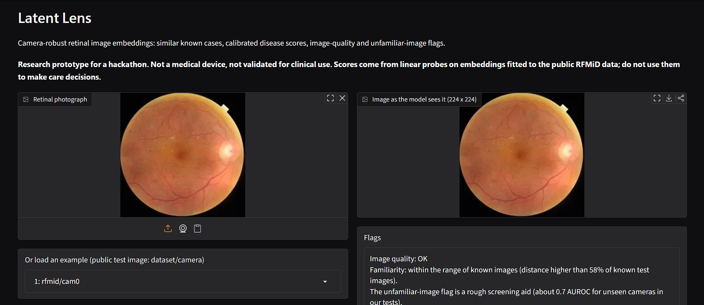
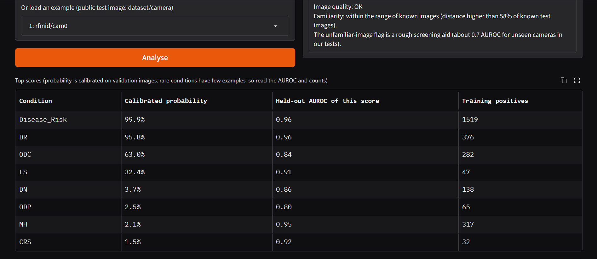
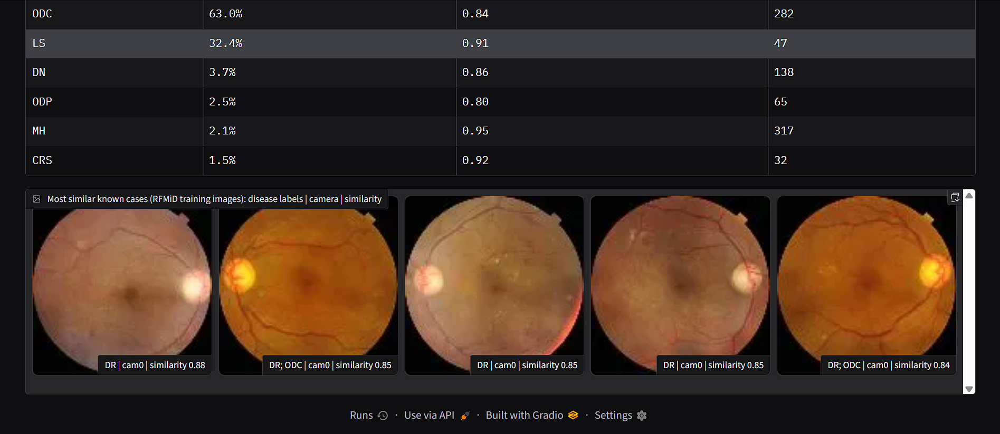

# Latent Lens: Camera-Robust Contrastive Embeddings for Rare Retinal Diseases

Group **Latent Lens** · ZEISS India BeyondCode'26 · Theme 2 (Contrastive Learning for Rare Eye Diseases) · NIT Rourkela
Author: Alok Kumar (solo), Roll No. 225cs1005

> **Research prototype for a hackathon. Not a medical device and not validated for clinical use.**
> Nothing in this repository should be used to make care decisions.

---

## In one paragraph

Retinal (fundus) AI models are trained on a few cameras and then meet new ones. We fine-tune a small pretrained vision model (DINOv2-small) with contrastive learning on the public RFMiD data, add a simple **camera-style randomisation** step, and wrap the result in a **trust layer** (calibrated scores, an unfamiliar-image flag, an image-quality check and similar-case retrieval). Everything below comes from our own runs, with 3 seeds and paired bootstrap intervals. Where the result is weak, we say so.

## What we found (short version)

| # | Finding | Evidence |
|--:|:--|:--|
| 1 | **Naive contrastive fine-tuning can hurt on a camera it has never seen.** Plain SimCLR dropped cam2 from 0.803 to 0.742 macro AUROC. | 0.742 ± 0.023 over 3 seeds, against 0.803 for the frozen model |
| 2 | **Camera-style randomisation fixes it, with no labels, in about 6 minutes of GPU training.** Cam2 recovers to 0.825; cam0 and cam1 improve too (0.877 and 0.844). | better than plain SimCLR in 3/3 seeds on every held-out camera |
| 3 | **Rare diseases improve clearly over the frozen model:** 0.894 vs 0.837 macro AUROC (+0.058, 95% interval +0.023 to +0.099). 10-shot rare AUROC 0.849 vs 0.784. | 10 rare classes, paired bootstrap |
| 4 | **Adding labels of the common classes** (a supervised-contrastive term) lifts common-class AUROC to 0.929, level with a fully supervised fine-tune (0.928), while rare classes still tie it (0.890 vs 0.895). | step 8 |
| 5 | A calibrated, retrieval-backed **trust layer** works on top of the embeddings (ECE 0.024 after temperature scaling; retrieval precision@5 0.538). | `results/trust_summary.md` |

**Limitations::**
- A fully supervised fine-tune is still **better on unseen cameras** (cam1 0.870 vs 0.846, cam2 0.861 vs 0.838). We do not claim to beat supervised learning.
- The rare-disease gain over the frozen model comes from **contrastive fine-tuning in general**. Our camera-style step ties plain SimCLR on rare classes (+0.002, interval −0.022 to +0.027). Its gain is on common classes and unseen cameras.
- **Camera information is not removed** from the embeddings: a probe still guesses the camera with 0.97 to 0.98 accuracy, as for the frozen model (0.99).
- The **unfamiliar-image flag is only a rough screening aid** (about 0.7 AUROC for an unseen camera, and at or below chance when telling IDRiD from RFMiD).
- **No inference-speed advantage:** 21.6M parameters, 11.0 GFLOPs, about the same latency as ResNet50. The saving is in adaptation (7.1M trainable parameters, about 6 minutes per run).
- 19 RFMiD conditions have only 1 to 6 training positives (and 2 have none), so they **cannot be evaluated**. Per-class rare numbers are noisy (6 to 17 evaluation positives per class); read the macro numbers and intervals.

## The method

Base model: `vit_small_patch14_dinov2.lvd142m` (DINOv2-small, 224 px), warm-started from public weights. The last 4 transformer blocks, the final norm and a small projection head are trained (7.1M of 21.6M parameters) for 400 steps, batch 96, with **camera-balanced sampling**.

| Model | What it is | Labels used? |
|:--|:--|:--|
| Frozen DINOv2-S | no training, linear probes on the embeddings | no |
| Plain SimCLR (`b3`) | contrastive fine-tuning, standard augmentations | no |
| **Latent Lens (`b3_fmix`)** | SimCLR **plus a Fourier camera-style swap**: the low-frequency amplitude (β = 0.1) of an image is mixed (λ ~ U(0.3, 1)) with that of an image from a *different* camera, so colour and illumination style stop being a shortcut | no |
| Supervised fine-tune (`sup`) | same layers fine-tuned with BCE on common-class labels | yes |
| **Latent Lens + labels (`b3_fmix_sup`)** | Latent Lens plus a supervised-contrastive term on the 14 common classes (training labels only) | yes (common classes) |

Other ideas we tried and **dropped because the data said so**: false-negative masking (no effect) and cross-camera nearest-neighbour positives (slightly worse on an unseen camera). See the ablation ladder in [`docs/RESULTS.md`](docs/RESULTS.md).

Camera labels are not given in RFMiD; they are inferred from image size (cam0 2144×1424, cam1 4288×2848, cam2 2048×1536). IDRiD uses the same size as cam1.

## Results

Linear probes are fitted on RFMiD train. Numbers are macro AUROC, mean over 3 training seeds unless stated. Full tables, intervals and per-class results are in [`docs/RESULTS.md`](docs/RESULTS.md).

### 1. Unseen camera (the camera is never used for training or for fitting the probes)

| Held-out camera | Frozen DINOv2-S | Plain SimCLR | **Latent Lens** | Latent Lens + labels | Supervised |
|:--|--:|--:|--:|--:|--:|
| cam0 | 0.836 | 0.865 | **0.877** | 0.877 | 0.882 |
| cam1 | 0.810 | 0.816 | **0.844** | 0.846 | 0.870 |
| cam2 | 0.803 | 0.742 | **0.825** | 0.838 | 0.861 |

Latent Lens beats plain SimCLR on every held-out camera in 3/3 seeds. Frozen is a single run.

### 2. Common vs rare diseases (all cameras seen)

| | Frozen | Plain SimCLR | Latent Lens | Latent Lens + labels | Supervised |
|:--|--:|--:|--:|--:|--:|
| Common classes (15, test) | 0.890 | 0.898 | 0.915 | **0.929** | 0.928 |
| Rare classes (10, val+test) | 0.837 | 0.892 | 0.894 | 0.890 | 0.895 |
| Rare few-shot, 10 positives + 10 negatives | 0.784 | 0.851 | 0.849 | 0.868 | 0.863 |
| IDRiD diabetic retinopathy (transfer) | 0.899 | 0.898 | 0.908 | 0.917 | 0.914 |

Common = at least 30 training positives. Rare = 8 to 29 training positives and at least 4 positives in val+test.

### 3. Trust layer

| | Frozen | Plain SimCLR | Latent Lens |
|:--|--:|--:|--:|
| Calibration error (ECE) after temperature scaling | 0.030 | 0.029 | **0.024** |
| Retrieval precision@5 (5 nearest cases share a disease) | 0.423 | 0.528 | **0.538** |
| Macro AUROC under blur σ=2 / JPEG q20 / low contrast | 0.801 / 0.751 / 0.876 | 0.869 / 0.814 / 0.891 | **0.873 / 0.820 / 0.910** |

Retrieval is still biased towards the same camera (top-5 same-camera share 0.84 for Latent Lens vs 0.65 expected by chance), so we show the camera next to every retrieved case in the demo.

## Demo

A small Gradio app: upload a fundus photo (or load a public test example) and get calibrated disease scores, an image-quality check, an unfamiliar-image flag and the most similar known cases. The model is the final one, `b3_fmix_sup`.





The example above is a public RFMiD test image (cam0): quality OK, within the range of known images, high disease-risk score, and all five nearest known cases are diabetic-retinopathy images. The page itself carries the not-a-medical-device warning.

Run it yourself with `notebooks/latent_lens_demo_final.ipynb` (see below). The public link it prints only lives while the Kaggle session runs.

## Repository layout

```
.
├── README.md
├── MODEL_CARD.md                  intended use, data, metrics, limits
├── LICENSE                        MIT (code only)
├── requirements.txt
├── src/
│   ├── latentlens_poc0.py         step 0: find data, infer cameras, cache 224px images, frozen baselines
│   ├── latentlens_train.py        contrastive fine-tuning + evaluation (all variants), report tables
│   ├── latentlens_trust.py        unfamiliar score, calibration, retrieval, UMAP, stress test, efficiency
│   ├── latentlens_step5.py        supervised baseline, rare-class tables, bootstrap, held-camera summary
│   └── latentlens_demo.py         build demo assets, self-test, Gradio app
├── notebooks/                     the exact Kaggle notebooks that produced every number (step 0 to 8 + demo)
├── results/                       machine-written summaries of the early steps and the trust layer
├── figs/                          UMAP (camera vs disease), augmentation check, samples per camera
└── docs/
    ├── RESULTS.md                 all tables with intervals, ablations, per-class results
    └── images/                    demo screenshots
```

## How to reproduce

Everything was run on a free Kaggle GPU (T4 or P100). Each notebook is self-contained (it writes the scripts it needs) and prints `[ok]` / `[warn]` self-checks as it goes.

1. **Data (not included).** Add RFMiD and IDRiD to a private Kaggle dataset (see "Data and credits"). The notebooks find them under `/kaggle/input` whatever the folder names.
2. **Run the notebooks in order**, each with GPU on and Internet on (needed once to download the DINOv2 weights). From step 1 onwards, attach the earlier notebooks' outputs with *Add Input → Notebooks* so cached images and features are reused:

| Notebook | Purpose |
|:--|:--|
| `latent_lens_step0` | data audit, camera map, image cache, frozen baselines |
| `latent_lens_step1` | contrastive training (first variants) and held-out-camera runs |
| `latent_lens_step2` | more seeds, camera-centering check |
| `latent_lens_step3` | ablation ladder |
| `latent_lens_step4` | final-model seeds, trust layer, UMAP, stress test, efficiency |
| `latent_lens_step5` | supervised baseline, rare diseases, unfamiliar score |
| `latent_lens_step6` / `step7` | every camera held out (contrastive / supervised) |
| `latent_lens_step8` | hybrid (Latent Lens + labels) and final comparison |
| `latent_lens_demo_final` | build assets, self-test, launch the demo |

3. **Or run the scripts directly** (from `src/`, with the cache from step 0 in place):

```bash
python latentlens_poc0.py  --stage all                 # audit, cache, frozen baselines
python latentlens_train.py --variant b3_fmix --seed 0  # Latent Lens
python latentlens_train.py --variant b3_fmix --hold cam2 --seed 0   # camera 2 never seen
python latentlens_step5.py --stage rare                # rare vs common tables with bootstrap intervals
python latentlens_train.py --stage report              # table of every finished run
```

Seeds, support sets for few-shot, class definitions and metrics were fixed **before** looking at results (see the docstrings at the top of each script).

## Evaluation protocol and disclosures

- Contrastive training uses only unlabeled RFMiD **train** images (and never the held-out camera). Probes are fitted on train and scored on val/test, on the held-out camera and on IDRiD (through an RFMiD diabetic-retinopathy probe).
- Few-shot support sets use fixed seeds shared by every model. Confidence intervals come from paired bootstrap over evaluation images.
- A circular retina mask is applied to every input of every model, including the frozen baseline.
- The final variant was chosen after seeing results on the same splits (no untouched final test set). Treat the numbers as development results.
- IDRiD uses the same camera type as RFMiD cam1, so it tests population/label shift more than a new device.
- Camera identity is inferred from image size, not given by the dataset.
- The frozen baseline is a single run (it has no training randomness to average over).
- cam2 has only 150 training images and few disease positives, so held-out cam2 numbers are noisier.

## Data and credits

- **RFMiD**: Retinal Fundus Multi-Disease Image Dataset (Pachade et al., 2021), CC BY 4.0, IEEE DataPort. 3,200 images, 46 conditions, official split 1,920 / 640 / 640.
- **IDRiD**: Indian Diabetic Retinopathy Image Dataset (Porwal et al., 2018), CC BY 4.0.
- **DINOv2** (Oquab et al., 2023): pretrained weights loaded through `timm` (`vit_small_patch14_dinov2.lvd142m`); see its own licence.
- Ideas we build on: SimCLR (Chen et al., 2020), supervised contrastive learning (Khosla et al., 2020), Fourier amplitude mixing for domain generalisation (Xu et al., 2021).

The datasets and weights are **not** redistributed here and keep their own licences. The code is MIT-licensed.

## Contact

Alok Kumar · NIT Rourkela · Roll No. 225cs1005 · Group Latent Lens
